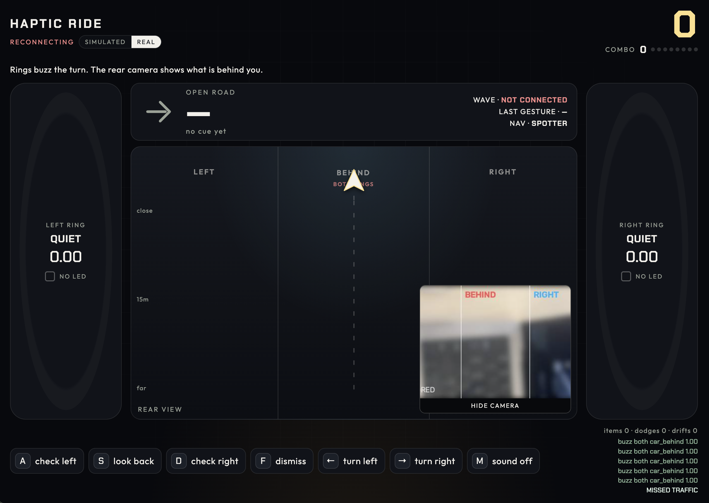

# Haptic Ride

Haptic Ride lets cyclists navigate and spot cars behind them by feel, so their eyes stay on the road.

## What it does

- A rear camera runs YOLO on the Mac and sorts traffic into **LEFT**, **BEHIND**, and **RIGHT**. The overlay shows the boxes and the class (car, person, bike, bus, truck).
- **DataFeel Dots** buzz the matching wrist. A car directly behind buzzes both wrists together.
- Turn cues are an amber LED and a pulse. **SOON** is a steady glow. **NOW** blinks. Cues come from a teammate's **spotter** page or from **phone GPS**.
- A **Genki Wave** reads real turns from the IMU (about 45° of yaw) and a flick dismisses the current car warning. The Wave does not buzz. The Dots do.
- Scoring is Mario Kart-style and rewards attention. A shoulder check on a warning is an item box. A fast close is a blue shell. A Wave turn that matches the cue during NOW is a drift boost. Missing a car, or missing NOW, breaks the combo.

## What it looks like



A quick tour of the overlay, top to bottom:

- **Header.** `HAPTIC RIDE`, the hub connection status, and a **SIMULATED / REAL** toggle for the traffic source.
- **Score** (top right), big, with a **COMBO** meter under it.
- **Ring panels**, left and right. Each wrist shows its state (`QUIET` when idle), the current buzz intensity (`0.00`–`1.00`), and an LED indicator.
- **Nav card.** An arrow and the turn cue (`OPEN ROAD / no cue yet` when there is none), plus status for the Wave ring connection, the last gesture, and the nav source (`SPOTTER`).
- **Rear view.** Split into **LEFT / BEHIND / RIGHT** zones with a distance scale (close, 15 m, far). A detected rider or car appears as a marker in its zone. In the screenshot it is in **BEHIND**, labeled `both rings`.
- **Live camera** (picture-in-picture) with the same zone lines drawn over it.
- **Keyboard row.** `A` check left, `S` look back, `D` check right, `F` dismiss, `←` / `→` turn, `M` sound off. These let you play in SIMULATED mode with no hardware.
- **Event log** (bottom right), e.g. `buzz both car_behind 1.00`, with item, dodge, and drift counters.

**Try it without hardware.** From the repo root, run `./run.sh`. It starts the simulated bridge (`bridge/fake_bridge.py`) and the engine, then open [http://127.0.0.1:8641](http://127.0.0.1:8641) and use the keys above.

## Hardware

- **DataFeel Dots** on **El Jefe** (USB serial). One chain or one module per wrist.
- **Genki Wave** on the rider's hand (Bluetooth). Input only.
- **iPhone** as the rear camera, through Continuity Camera.
- **MacBook** in the backpack. It runs the hub, the engine, the ring client, and the Wave client.

## Architecture

```text
iPhone (Continuity Camera)
        │
        ▼
camera_bridge.py                 hub. WebSocket :8765, pages :8641
        │
        ▼
engine/game.py                   the only scorer. picks the buzz
        │
        ├── overlay/index.html   HUD
        ├── /spotter             teammate calls the turn
        ├── /nav                 phone GPS calls the turn
        ├── rings/datafeel_rings.py    drives the Dots
        └── rings/wave_input.py        Wave turns and flicks
```

Every process is a client of the hub. The hub only forwards JSON. Run one engine. A second engine will score twice.

**Protocol.** One JSON object per WebSocket text frame.

```json
{"type": "car", "side": "left", "dist": 14.2, "speed": 4.0, "id": "cam-left", "class": "car"}
{"type": "nav", "turn": "right", "in_m": 30, "source": "spotter"}
{"type": "nav", "clear": true, "source": "spotter"}
{"type": "turn", "turn": "left", "side": "left"}
{"type": "dismiss"}
{"type": "shoulder_check", "side": "right"}
{"type": "look_back"}
{"type": "buzz", "side": "both", "pattern": "car_behind", "intensity": 0.8}
```

`side` on a car is `left`, `right`, or `behind`. `speed` is closing speed in m/s. `dist` and `in_m` are meters. Nav `source` is `spotter`, `gps`, or `scripted`. Phone GPS may also send `accuracy` in meters. SOON is inside 45 m. NOW is inside 12 m.

`buzz` goes to the Dots and the overlay. `pattern` is `turn_soon`, `turn_now`, `car_approach`, `car_behind`, `blue_shell`, or `combo`. `side` is `left`, `right`, or `both`. `intensity` is 0 to 1. The engine also sends `state` (score, rings, nav) for the HUD. `hello` is what the hub says when you connect.

## Quick start

macOS, from the repo root.

```bash
python3 -m venv .venv
source .venv/bin/activate
python3 -m pip install -r requirements.txt
```

The DataFeel package is not on PyPI. With the same venv still active, clone the samples outside this repo and install its `Python` folder:

```bash
git clone https://github.com/DataFeel/devkit-samples.git /tmp/devkit-samples
python3 -m pip install /tmp/devkit-samples/Python
```

Four terminals. Activate `.venv` in each one. Start them in this order.

**1. Camera hub** (prints the Mac's LAN address):

```bash
python3 bridge/camera_bridge.py --list-cameras
python3 bridge/camera_bridge.py --camera 0
```

**2. Engine:**

```bash
python3 engine/game.py --url ws://127.0.0.1:8765
```

**3. DataFeel Dots:**

```bash
python3 rings/datafeel_rings.py --url ws://127.0.0.1:8765
```

**4. Genki Wave.** `--discover` prints a CoreBluetooth UUID. Pass that UUID to `--addr`:

```bash
python3 rings/wave_input.py --discover
python3 rings/wave_input.py --addr <UUID> --url ws://127.0.0.1:8765
```

Open the HUD at [http://127.0.0.1:8641](http://127.0.0.1:8641). On the overlay, `←` / `→` turn, `A` / `D` shoulder-check, `S` looks back, `F` dismisses.

On a phone on the same Wi-Fi, the indoor demo is the spotter. GPS is the outdoor page:

```text
http://<mac-lan-ip>:8641/spotter
http://<mac-lan-ip>:8641/nav
```

Spotter buttons: LEFT SOON and RIGHT SOON (30 m), LEFT NOW and RIGHT NOW (5 m), CLEAR. Default `--nav spotter` keeps the scripted route from also calling turns. `--nav phone` uses `/nav`. `--nav scripted` restores the demo route.

## Troubleshooting

- **Port in use.** Something else, often `./run.sh`, already has 8765 or 8641. Stop it. Run only one engine.
- **No camera picture.** macOS must allow the terminal to use the camera. Continuity Camera is one of the indexes from `--list-cameras`. The live view is the corner of the overlay, not a separate window.
- **First launch is slow.** Ultralytics downloads `yolo11n.pt` once.
- **Dots are silent or on the wrong wrist.** The port looks like `/dev/cu.usbserial-*` (use `cu.`, not `tty.`). `--swap` exchanges wrists. `--left-addr` and `--right-addr` override the scan.
- **Wave connects and then goes quiet.** Turn it on with the middle button. It cannot already be connected to Softwave or the Mac. If a session sticks, hold the top button for a few seconds. `--invert` swaps left and right if a turn comes out mirrored.
- **iPhone GPS has no position.** Safari only shares location on HTTPS. Run `python3 bridge/camera_bridge.py --https` and open `https://<mac-lan-ip>:8641/nav`, or tunnel both ports and open `/nav?url=wss://<websocket-tunnel>`. `/spotter` works on plain HTTP.

## What we tried

The Infineon **BGT60TR13C** radar was the first rear sensor. Indoor clutter showed up as false targets a few meters out, so the demo uses the camera instead. The radar code is still in the repo for reference: `bridge/real_bridge_stub.py` and `bridge/radar_filter.py`.

## Credits

This code was written during the **INTERFACE** hackathon. It is built on starter libraries: [Ultralytics](https://github.com/ultralytics/ultralytics) YOLO, [genki-wave](https://pypi.org/project/genki-wave/), the [DataFeel devkit-samples](https://github.com/DataFeel/devkit-samples) Python package, [Leaflet](https://leafletjs.com/) and [OpenStreetMap](https://www.openstreetmap.org/), and the [websockets](https://websockets.readthedocs.io/) library.
